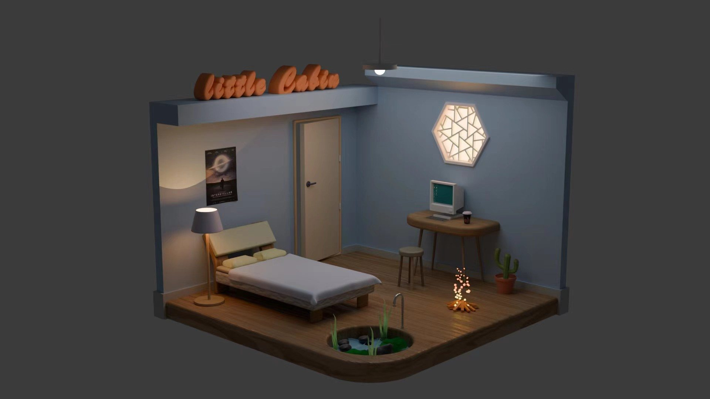

# Blender studies & Little Cabin

Editable Blender projects by **Aikun Wang** — shared for learning, experimentation, and reuse.

## Download the editable projects

[**Download Blender source files (ZIP, 274 MiB)**](https://github.com/philipwang1128-droid/blender-studies/releases/download/v1.0.0/Aikun-Wang-Blender-Source-v1.zip)

[View releases](https://github.com/philipwang1128-droid/blender-studies/releases)

The automatic GitHub “Source code (zip)” contains only this repository's documentation. The Blender projects are in the separately attached source bundle.

Extract the entire ZIP and start with **Aikun-Wang-Blender/Little cabin WATER2.blend** in **Blender 4.1**.

## What's included

- Nine editable project .blend files: cabin variants, modeling exercises, and a chamber study.
- Three supplied Poly Haven material/model libraries, textures, existing fluid caches, and render examples.
- Relative texture paths, an English/Chinese guide, attribution notes, and a file manifest.

Read [Getting started](blender-github/GETTING_STARTED.md) for the file inventory, release changes, and known missing resources.

## License & credits

Original modeling, scene composition, and documentation by Aikun Wang are licensed under **[CC BY 4.0](https://creativecommons.org/licenses/by/4.0/)**. Credit Aikun Wang, link to the license, and indicate your changes.

[License](blender-github/LICENSE.md) · [Third-party asset information](blender-github/THIRD_PARTY_ASSETS.md)

Poly Haven assets retain their CC0 terms. Other supplied reference imagery is not relicensed under CC BY 4.0. See the asset notes before reusing individual reference images.

## Validation & limitations

All twelve .blend files were reopened in Blender 4.1.1; object counts and available image dependencies were checked. Source files on the author's computer were not overwritten.

The latest cabin variant is missing white-abstract-ornament-textile.jpg. Three separate library-preview resources are also unavailable. These references are documented in the manifest. Existing fluid caches are included as supplied; the full simulation and final renders have not been revalidated.

## 中文

请从右侧 Releases 下载附件 Aikun-Wang-Blender-Source-v1.zip，完整解压后用 Blender 4.1 打开 Little cabin WATER2.blend。GitHub 自动生成的 Source code 压缩包仅含仓库说明，不含工程。

欢迎学习、修改和分享原创建模，请保留 Aikun Wang 署名及 CC BY 4.0 许可链接。第三方素材采用各自的许可，缺失贴图等说明见 GETTING_STARTED.md。

[Portfolio](https://aikunwang.com/projects.html#work)
